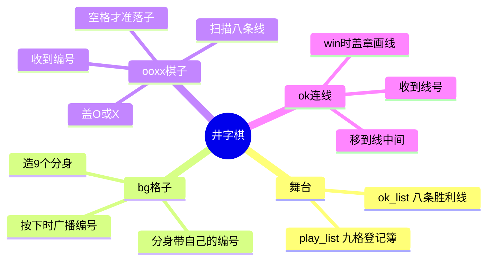
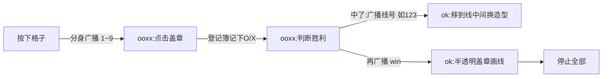

# 图形化编程 教案：井字棋（双人对战）

- 程序文件：06-井字棋.sb3（157 积木 / 4 角色）
- 来源：STEAM 教育学习网教程 https://steam.oxxostudio.tw/category/scratch/example/ooxx.html
- 备课状态：待备；用户亲手跑过：否
- 难度判断：**角色少但不简单**。角色只有 4 个，难在四处——①分身各自带编号（私有变量）②两张列表当登记簿 ③八线双重循环扫描判胜 ④广播一棒接一棒传四手。

## 〇、本班信息（上课前只改这一块）

### {班级：待定}

- 上课：{YYYY-M-D 周X HH:MM–HH:MM}
- 应到人数：{n}
- 本课＝本班第 {n} 次课
- 上节进度：{}
- 本班注意：{}

## 一、思维导图

### 图1：程序全景（角色 → 干什么）

### 图2：一手棋的接力（谁交给谁）

> 讲课就按这两张图走：先认清四个角色各管什么（图1），再盯着一手棋看接力（图2）。

## 二、变量与列表速查（先认东西）

| 名字 | 大白话 | 谁在用 |
|---|---|---|
| pos（全局） | 分身出生的计数器，1→9 | bg 造分身时数 |
| **pos_local（bg 本角色私有）** | **每个分身兜里自己的编号**，分身各一份 | 分身按下时广播它 |
| play_list（列表） | 九格登记簿：第 n 项 ↔ 第 n 格，空/`o`/`x` | 舞台建表，ooxx 落子时写、判胜时读 |
| ok_list（列表） | 八条胜利线：123 456 789 147 258 369 159 357 | 舞台建表，判胜时逐条查 |
| x / y | 正在查第几格 / 第几线 | 判断胜利里循环用 |
| check_O / check_X | 这条线上 O 和 X 各有几个，数到 3 就赢 | 判断胜利里计数 |
| num | 临时取一个格子的内容（取字符用） | 判断胜利里中转 |

> 变量名是英文，学生若吃力，课堂上统一喊中文：pos_local＝我的编号、play_list＝登记簿、ok_list＝胜利线。

## 三、课程目标

1. **认知**：能说清「分身私有变量各一份」「列表第 n 项对应第 n 格」「广播是接力不是点名」。
2. **实践**：搭出登记簿、九个带编号的分身、落子盖章、八线判胜、胜利连线。
3. **应用**：两人一台电脑能完整下完一局，三连有连线、有胜负。

## 四、任务单（验收标准）

做完后逐条打勾：

1. 绿旗后登记簿有 9 个空项、胜利线表有 8 条线。
2. 舞台上出现 3×3 共 9 个格子。
3. 点某格，棋子 O 落在该格；再点另一格，X 落下（轮流）。
4. 点已经有子的格，**不落子**。
5. 一方三连时：出现一条半透明连线、棋子停住不再响应。
6. 没三连时游戏继续（**注意：原版没有判平局，9 格下满不收口，当拓展题**）。

## 五、单元清单

> 每个单元做完都能单独跑、看得见变化。预计时间列空着，用户真跑后填实测。

| # | 单元目标 | 积木要点 | 一句人话 | 常见坑 | 做完能怎样 | 预计 |
|---|---|---|---|---|---|---|
| 1 | 舞台建两张表 | 清空+重复9次加空项；清空+加8条线 | 开局先备好登记簿和答案册 | 加在错的表上；漏线 | 两张表数据正确 |  |
| 2 | 铺九个格子 | 自定义「分身侦测方块」：双重循环、克隆、移位置 | 从左上角开始，造一个往右挪，一行三个换行 | 克隆不放在最内层；换行忘归位 | 3×3 九宫格 |  |
| 3 | 格子会报数 | 分身：虚像100、显示；等(碰到鼠标且按下)→广播编号；等松开 | 透明玻璃门，点我我就喊自己的号 | 虚像写成隐藏就碰不到；缺「等松开」会连下 | 点格子能看到广播 |  |
| 4 | 落子盖章 | 自定义「点击盖章 编号 x y」：该格空才落、移过去、登记簿记 O/X、盖章、下一造型 | 空格才准坐，坐上就盖章、换人 | 登记簿项号要用传入编号；先移后记反 | 点格子出现 O/X 且轮流 |  |
| 5 | 判断胜利 | 自定义「判断胜利」：8 线 × 3 格双重循环，数 O/X，=3 广播线号+win | 一条条答案对，对一条就数，凑三个一样就赢 | check 计数每条线前要归零；字符取第1个 | 三连时广播 win（此时还没画线） |  |
| 6 | 胜利连线 | ok：收到线号→移到线中点换造型；收到 win→虚像50 盖章→停止全部 | 先站好位置等指令，win 一到就盖章定局 | 线号对应坐标/造型错；顺序反 | 三连有半透明连线、全局停止 |  |

## 六、课堂流程

### 1. 复习导入（约 8 分钟）

- 复习提问（按本班往期）：克隆时私有变量会不会一起复印？列表第 3 项指什么？
- 导入：黑板画 3×3，问「两个人下，程序要替你们记住哪几件事？」→ 引出：谁占了哪格、轮到谁、谁连成了线。对应登记簿、O/X 造型、胜利线表。

### 2. 单元推进（主体）

> 每单元循环：**演示一小段 → 学生跟做 → 巡查答疑 → 点名验证 → 再开下一个**。不一次讲完。

- **单元 1（舞台建表）**：重点让学生打开两张表的监视器，亲手数 9 和 8。
- **单元 2（铺格子）**：参照以前铺格子的课；强调分身放循环最里面。
- **单元 3（格子报数）**：高光实验——把虚像 100 改成 0，九个格子显形；点不同格，让学生看广播的号不一样（点广播积木看高亮）。
- **单元 4（落子盖章）**：先只做 O，连点验证「空格才落」；再接「下一造型」实现轮流。
- **单元 5（判胜利）**：全课最难。慢动作拆：一条线（如 123）手动数给学生看，再交给双重循环。强调每查新线 check_O/check_X 归零。
- **单元 6（连线）**：对照 8 条线中点位置表（教师答案区），做完演示一局真胜利。

### 3. 拓展（只给提前做完的学生）

1. **判平局**：9 格下满且无人三连时，广播平局提示。（提示：判断 play_list 里还有没有空项）
2. 加比分：O 赢 X 赢各计分，绿旗不清零。
3. 落子加声音。
4. 思考题：怎么让电脑当对手（只讨论思路，不要求实现）。

### 4. 收尾（最后 10 分钟）

口头小题（题面不含答案）：

1. 为什么每个分身喊出的编号不一样？靠哪个变量？
2. 点已经有子的格为什么不落子？是哪块积木拦住的？
3. 八条胜利线存在哪？判胜时为什么要双重循环？
4. 「win」广播之后有几个角色动了？各干什么？

## 七、教师答案区（投屏避开）

- **收尾题答案**：
  1. pos_local 是 bg 的本角色私有变量，克隆那一刻连同当前值复印给分身，各一份（1~9）。
  2. 「点击盖章」里第一句判断：play_list 第(编号)项 = 空，才往下走。
  3. 存在 ok_list；外层循环走 8 条线、内层走一条线的 3 个格，所以双重循环。
  4. 两个：ooxx 自己收到 win 隐藏；ok 收到 win 盖章画线后停止全部。
- **八条线的中点坐标与 ok 造型**（单元 6 用）：

  | 线号 | 中点 (x, y) | ok 造型 |
  |---|---|---|
  | 123 横上 | (0, 95) | 1（横线） |
  | 456 横中 | (0, 0) | 1 |
  | 789 横下 | (0, -95) | 1 |
  | 147 竖左 | (-95, 0) | 2（竖线） |
  | 258 竖中 | (0, 0) | 2 |
  | 369 竖右 | (95, 0) | 2 |
  | 159 主对角 | (0, 0) | 3 |
  | 357 副对角 | (0, 0) | 4 |

- **本课最大卡点（预判，实测后修正）**：单元 5 的双重循环 + 每条线计数归零。慢一点，用一条线手演再推广。
- **原版已知缺口**：无平局判定；无再来一局按钮（靠重新点绿旗）。

## 八、课前准备

- [ ] **用户亲手从头跑一遍程序**（硬门槛：没跑等于没备），重点跑单元 5/6
- [ ] sb3 双击能打开，TurboWarp 离线可用
- [ ] 六个单元逐段过一遍，每段单独能演示
- [ ] 两张表监视器、pos_local 的演示位置自己先点一遍
- [ ] 分发方式、教具、电源

## 九、课后

- [ ] 记录真实进度：上到第几单元、哪些学生卡在哪
- [ ] 把单元清单「预计」列改成实测时间
- [ ] 拍课堂/成果照，发「调度中枢」群
- [ ] 写课评（先发用户审批）、排课表状态归账
- [ ] 收回教具、远程关机、关灯关空调
